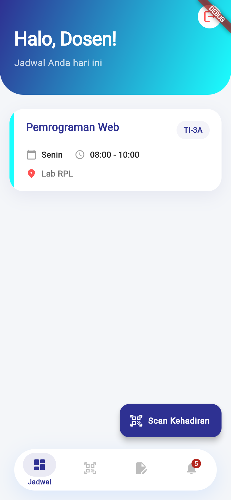
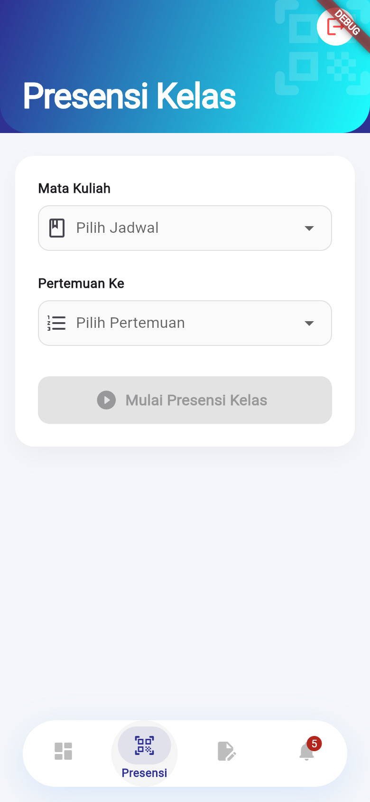
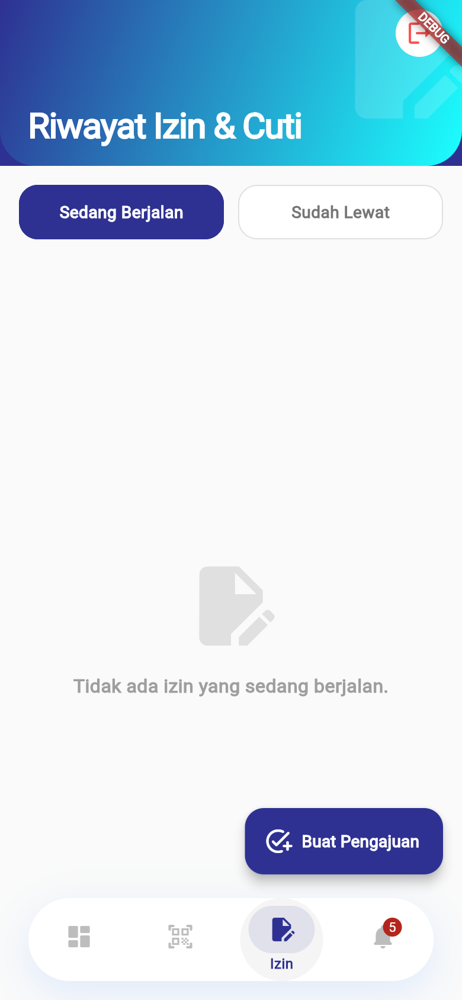
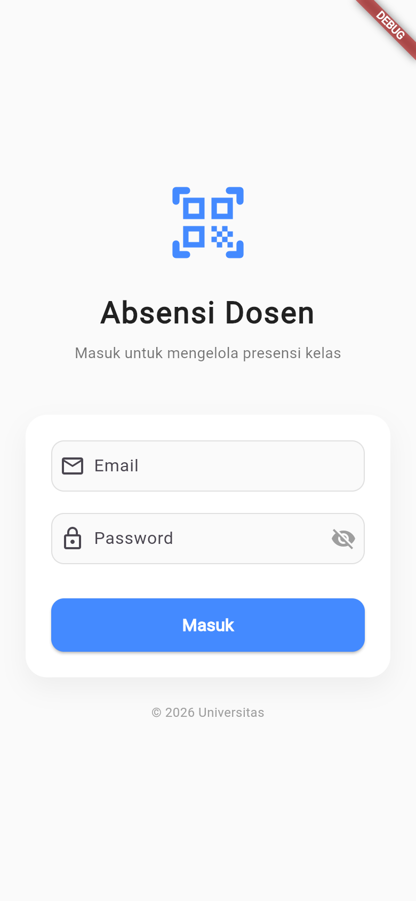

# Absensi Dosen - Mobile

Aplikasi Flutter untuk sistem absensi dosen dan pengelolaan presensi mahasiswa. Aplikasi ini menggunakan backend REST API pada repository [absensi-dosen-backend](https://github.com/Salman-artz/absensi-dosen-backend).

---

## 📸 Screenshots Aplikasi Mobile (Live Web/Chrome & Android)

<p align="center">
  
  &nbsp;&nbsp;
  
  &nbsp;&nbsp;
  
  &nbsp;&nbsp;
  
</p>
<p align="center">
  <em>(1) Jadwal Kuliah & Kehadiran &nbsp;|&nbsp; (2) Presensi Pertemuan & QR &nbsp;|&nbsp; (3) Pengajuan Izin/Sakit &nbsp;|&nbsp; (4) Login Sesi Autentikasi</em>
</p>

---

## Fitur

### Dosen

- Login dengan autentikasi JWT
- Melihat jadwal mengajar
- Scan QR untuk absensi dosen
- Melihat riwayat kehadiran
- Mengajukan izin, cuti, sakit, atau dinas luar
- Membuka pertemuan kuliah 1-16
- Mengisi presensi mahasiswa
- Melihat daftar mahasiswa dalam kelas
- Mengunduh rekap presensi dalam PDF
- Melihat notifikasi dari sistem

### Admin dan Staff TU

- Dashboard ringkasan kehadiran
- Mengelola akun pengguna
- Mengelola mata kuliah, ruang, dan jadwal
- Membuat QR sesi absensi
- Mengimpor data mahasiswa dari file Excel
- Mengelola grup kelas dan mahasiswa
- Menyetujui atau menolak pengajuan izin
- Mengunduh rekap presensi

## Tech Stack

- Flutter 3.x
- Dart SDK 3.5.4+
- Riverpod untuk state management
- Dio untuk HTTP client
- GoRouter untuk navigasi
- Flutter Secure Storage untuk token
- Mobile Scanner untuk scan QR
- QR Flutter untuk membuat QR

## Requirements

- Flutter SDK yang mendukung Dart 3.5.4 atau lebih baru
- Android Studio dan Android SDK untuk Android
- Xcode untuk build iOS di macOS
- Backend Absensi Dosen yang sedang berjalan

## Menjalankan Aplikasi

Pasang dependency Flutter:

```bash
flutter pub get
```

Jalankan pada device atau emulator:

```bash
flutter run --dart-define=API_BASE_URL=http://10.0.2.2:4000/api
```

Gunakan URL berikut sesuai target:

| Target | `API_BASE_URL` |
|---|---|
| Android Emulator | `http://10.0.2.2:4000/api` |
| iOS Simulator | `http://127.0.0.1:4000/api` |
| Device fisik | `http://IP-KOMPUTER-ANDA:4000/api` |
| Backend deployment | URL backend + `/api` |

Contoh untuk device fisik:

```bash
flutter run --dart-define=API_BASE_URL=http://192.168.1.10:4000/api
```

Nilai default di source code mengarah ke alamat IP lokal tertentu. Untuk tim atau mesin lain, selalu berikan `API_BASE_URL` melalui `--dart-define`.

## Struktur Project

```text
lib/
  core/
    api/         # Dio client, JWT header, dan refresh token
    models/      # Model data aplikasi
    router/      # Routing dan redirect berdasarkan role
    widgets/     # Shell navigasi utama
  features/
    auth/        # Login dan autentikasi
    attendance/  # Scan dan generate QR
    dashboard/   # Dashboard admin
    leave/       # Pengajuan dan approval izin
    master_data/ # Mata kuliah, ruang, dan pengguna
    meeting/     # Pertemuan dan presensi mahasiswa
    notification/ # Notifikasi
    schedule/    # Jadwal dosen dan admin
    student/     # Import dan pengelolaan mahasiswa
```

## Build

Android APK:

```bash
flutter build apk --release --dart-define=API_BASE_URL=https://api.example.com/api
```

Web:

```bash
flutter build web --release --dart-define=API_BASE_URL=https://api.example.com/api
```

## Quality Checks

```bash
flutter analyze
flutter test
```

## Catatan Keamanan

- Jangan menaruh token, password, atau URL database di source code.
- Gunakan HTTPS untuk backend production.
- Jangan commit file hasil build atau konfigurasi lokal.
